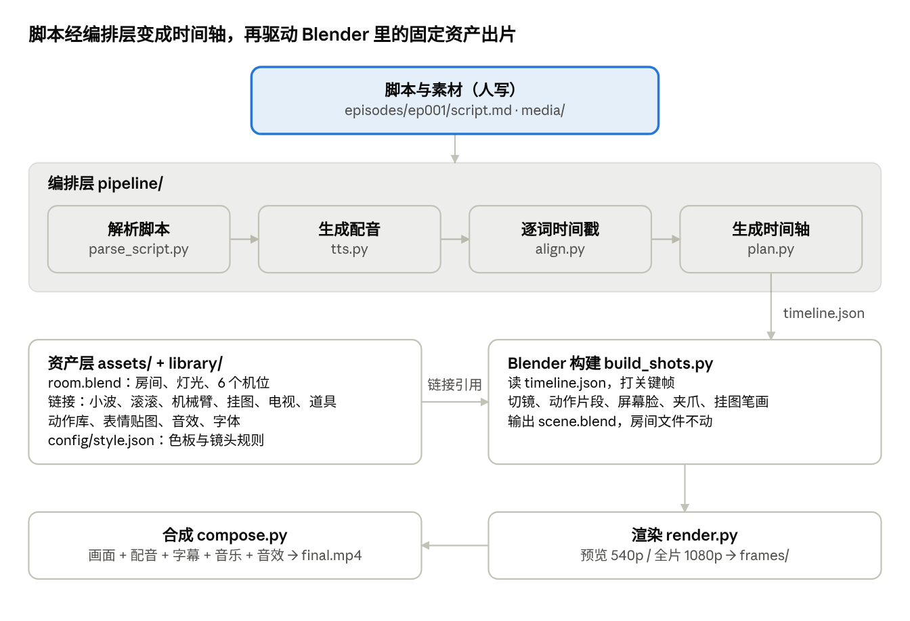
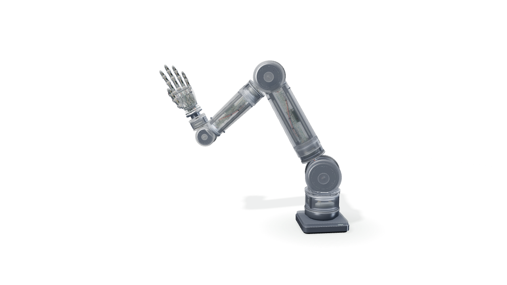

# 技术方案

> 导出自 Claude 在线文档《小波深夜电台 · 节目设定》的"技术方案"标签页（2026-10-27）。节目设定见 [00_节目设定.md](00_节目设定.md)；建模任务的执行规范以 `AGENTS.md`、`docs/01`–`05` 和 `tasks/` 为准。

先搭编排管线和小波，用 10 秒样片验证整条链路；机械臂重做一个复古风简化版，现有 K3.1 资产只借用比例、关节布局和姿态库思路。所有资产都由 Python 脚本生成，可以重跑、可以改参数。

## 总体架构



资产层只建一次，每期变化的只有脚本和素材；配音和时间戳同时交给合成步骤，用来做声音轨和逐字字幕。

## 开发顺序

按风险从高到低排：先证明"脚本 → 成片"的自动化链路能跑通，再往里填资产。每个阶段验收通过再进入下一个。

| 阶段 | 做什么 | 交付物 | 验收标准 |
| --- | --- | --- | --- |
| 0. 环境 | 在 Mac 上装 Blender（4.2 及以上，带 EEVEE Next）、ffmpeg、Python 环境；开通 TTS | 一个能在无界面模式下渲出一帧的测试脚本 | 命令行一条命令出图，记录单帧耗时 |
| 1. 房间白模与灯光 | 房间结构、主要家具的简单几何体、六个机位、夜晚布光、色板材质 | room.blend + 六张机位定帧 | 你确认氛围和构图；单帧渲染时间可接受 |
| 2. 小波 | 建模、绑定、屏幕脸着色器、嘴巴音量驱动、眨眼、待机循环 | xiaobo.blend + 表情定帧表 | 小波说一句话的 10 秒测试，嘴和声音对得上 |
| 3. 编排管线 MVP | 脚本解析、TTS、逐词时间戳、时间轴 JSON、自动切镜、合成 | pipeline/ 下一套脚本 | 改一句脚本重跑，成片自动跟着变 |
| 4. 挂图与电视 | 画架、翻页、逐笔书写；电视屏幕播放视频、推进转场 | flipchart.blend、tv.blend + 对应标签 | 挂图内容和电视画面都由脚本标签驱动 |
| 5. 机械臂与道具库 | 简化版机械臂、IK、抓放函数、第一批道具 | arm.blend、props/ | 一个标签完成一次抓放，放下时刻对上关键词 |
| 6. 滚滚 | 建模、滚动和弹跳、天线摆动、动作库 | gungun.blend | 六个动作全部能用标签触发 |
| 7. 整期试制 | 用一篇真实脚本做一期 3–5 分钟成片，配字幕、音乐、音效 | 第 1 期成片 + 渲染耗时记录 | 从交脚本到成片不需要人手动改 Blender |

阶段 2 和 3 可以并行：管线先用一个临时方块代替小波。

## 目录与资产组织

每个资产一个生成脚本加一个 .blend 文件，房间文件用"链接"方式引用角色和道具；改了小波，所有剧集自动用上新版。

```
video-model/
  config/
    style.json        # 色板、灯光参数、镜头规则、默认时长
    tags.json         # 脚本标签定义（镜头/表情/动作/挂图/电视/机械臂/滚滚）
  assets/
    build/            # 每个资产的生成脚本：build_room.py、build_xiaobo.py …
    room.blend        # 房间 + 灯光 + 6 个机位（链接下面的资产）
    xiaobo.blend
    gungun.blend
    arm.blend
    flipchart.blend
    tv.blend
    props/            # 道具库，每个道具一个 .blend
  library/
    actions/          # 动作库：小波、滚滚、机械臂的动作片段
    faces/            # 屏幕脸表情和图标贴图
    sfx/              # 调频声、伺服声、滚滚电子音等原创音效
    fonts/            # 可商用授权的手写字体
  pipeline/
    parse_script.py   # 解析脚本和标签
    tts.py            # 生成配音 + 收音机效果
    align.py          # 逐词时间戳
    plan.py           # 生成 timeline.json（套镜头规则）
    build_shots.py    # 在 Blender 里按时间轴打关键帧
    render.py         # 预览 / 全片渲染，支持分段和断点续渲
    compose.py        # ffmpeg 合成：画面 + 字幕 + 配音 + 音乐 + 音效
    run_episode.py    # 一条命令跑完整期
  episodes/
    ep001/
      script.md       # 带标签的脚本（人写）
      media/          # 电视要播的视频、图片
      audio/          # 配音和时间戳
      timeline.json   # 自动生成，可人工微调
      frames/         # 渲染帧
      final.mp4
```

生成脚本是"源代码"，.blend 是"产物"：要改造型就改脚本参数重跑，不在 Blender 里手工改。整个文件夹用 git 管理版本，渲染帧和音频不入库。

## 建模方法

所有资产都用"基础几何体 + 倒角 + 细分曲面"的风格化建模，材质用程序化着色器，不依赖手绘贴图；角色都是硬质零件，绑定用刚性父子关系，不刷权重。

**通用规则**

- 单位用米，按真实尺寸建：小波站高约 0.9 米，滚滚直径约 0.3 米，房间约 5 × 4 米，层高 2.7 米（可调）
- 每个物体命名、分集合，脚本靠名字找对象
- 倒角修改器 + 细分曲面做出圆润的玩具感；视口保持低细分，渲染时再提高
- 单个角色控制在几万个三角面以内，整个场景控制在百万级以内
- 材质统一从 config/style.json 读色值，改品牌色只改一处
- 植物、书本等陈设可以用 CC0 授权的公开模型库（如 Poly Haven），再换成色板里的颜色

**房间**

- 墙、地、窗用平面和方块；木格栅用阵列修改器重复一根木条
- 家具（沙发、矮桌、工作台、矮柜）用圆角方块拼，保持中古风的低矮、圆润
- 球形灯、蘑菇台灯、熔岩灯用旋转体加自发光材质，熔岩灯里的液体用气泡状元球做缓慢循环动画
- 窗外是一张虚化的城市夜景平面 + 冷蓝色面光，不建真实城市
- 六个机位各自一台摄像机，每台设好默认焦距、景深和"拉远 / 缓推"的起止位置

**小波**

- 头：横向胶囊形圆角方块，正面嵌入一块屏幕平面；两侧扬声器网罩用圆孔纹理或几何节点生成；天线由两段圆柱 + 顶端小球组成，缩放第二段即可伸缩
- 身体：圆角柱体躯干 + 两只两节手臂 + 连指手套形的手 + 轮式底座
- 绑定：一套骨骼（根、身体、头、天线 2 节、左右大臂 / 小臂 / 手），每个零件直接绑在一根骨头上；手臂加 IK，指向挂图时只给一个目标点
- 屏幕脸：一个自发光着色器，参数有眼睛形状、睁眼程度、嘴张合、脸色、图标编号、扫描线强度；眼睛和嘴用圆角矩形距离场画出来，图标从一张图标图集里取
- 嘴：用 Python 算配音每一帧的音量，平滑后写成"嘴张合"的关键帧
- 眨眼：用固定种子的随机间隔（3–6 秒），保证每次重跑结果一致
- 屏幕脸旁边放一盏和脸同色的小面光，让脸的颜色投到胸前和桌面

**滚滚**

- 一个球体加两条分型线，正面一块小屏幕（同一套屏幕脸着色器，只用两个圆点眼睛），头顶一根短天线
- 滚动：沿路径移动时，球体旋转角度 = 移动距离 ÷ 半径，由脚本自动计算，不会打滑
- 屏幕和天线始终朝上、朝前：只让外壳滚动，屏幕和天线由另一个不转的父物体带着走
- 弹跳和落地压扁用缩放关键帧；天线的惯性摆动由脚本按加速度算出一个衰减摆动

**翻页挂图**

- 画架：三根圆柱腿 + 横档 + 夹板
- 纸页：细分的平面，翻页用"简单形变"的弯曲修改器做弧度，再绕顶边旋转翻过去
- 内容：先把这一页要画的东西做成 SVG（文字用手写字体转轮廓，图形用简单路径），导入为曲线，用曲线的"生长"参数做逐笔书写；每一笔的开始时间由时间轴安排
- 文字的笔画顺序不必严格按书法笔顺，按从左到右、从上到下的轮廓顺序即可

**复古电视**

- 木纹外壳的圆角方块 + 稍微外凸的屏幕曲面 + 两个旋钮和天线
- 屏幕材质：视频或图片序列作为自发光贴图，叠加扫描线、边缘暗角和轻微辉光
- 推进转场：摄像机推到屏幕铺满画面的那一帧，在合成阶段切换到原始视频全屏播放，结束时反向拉回

## 机械臂：现有资产评估与新方案

结论：K3.1 机械臂资产不直接复用。它是一个精细的工程展示模型，比我们需要的桌面道具重约两个数量级，风格也不对；只借用它的比例、关节布局和姿态库思路，另做一个复古简化版。



**实测数据**（在云端用无头浏览器加载后统计）

| 项目 | 实测结果 |
| --- | --- |
| 格式 | Three.js 网页，几何体在运行时由 assembly.json（4801 个节点）和 wires.json（1369 条走线）生成，没有现成的 Blender 文件 |
| 结构 | 7 轴机械臂（J1–J7）+ 20 个自由度的五指灵巧手，带关节限位和手势库 |
| 尺寸 | 大臂 0.244 米，小臂 0.191 米，桌面尺度 |
| 网格数 | 3830 个 |
| 三角面 | 约 244 万；灵巧手占约 113 万，7 个关节各约 11 万 |
| 材质 | 34 种，含透射玻璃质感的磨砂外壳 |
| 内部细节 | 电路板、接插件、编织线束、绿色和金色导线，透过透明外壳可见 |
| 自带能力 | 导出 GLB；按时间逐帧精确渲染（1920×1080，15 秒 900 帧） |

**和我们需求的对照**

| 维度 | 现有资产 | 我们需要 | 判断 |
| --- | --- | --- | --- |
| 风格 | 冷灰白、透明外壳、展示内部电路 | 70 年代焦橙漆面 + 黄铜关节，不透明 | 不符：换成不透明外壳后，大部分内部细节看不见，白白占面数 |
| 复杂度 | 约 244 万面、3830 个网格 | 桌面道具级，2 万面以内、十几个零件 | 过重：场景管理、脚本遍历、渲染都会变慢 |
| 末端 | 五指灵巧手，20 个自由度 | 平行两指夹爪，一个"开合"参数 | 不适合批量：每种道具都要单独编排手指握持姿态 |
| 格式 | 运行时生成的 Three.js 场景 | Blender 原生资产 + 骨骼 + IK | 要导出 GLB 再导入，层级变成空物体，骨骼、IK、材质都要重做 |
| 材质 | 大量透射材质 | 哑光漆面和金属 | 透射在 Eevee 里昂贵且容易出噪点 |

在云端用软件模拟 GPU 渲染一帧约 13 秒。这个数不代表你 Mac 上的速度，只说明它很重。

**可以借用的部分**

- 比例和关节布局：大小臂长度、各关节的旋转轴和限位，直接拿来定新机械臂的骨骼
- 姿态库的做法：预设姿态 + 平滑插值，和我们的动作库思路一致
- 逐帧精确渲染的做法：每一帧都由"时间 → 状态"算出来，不依赖实时播放，这正是批量渲染要的性质
- 五指手：留作以后"机器人专题"一期的特写道具，需要时再导出 GLB、换材质，不进入常规流程

**新机械臂方案**

- 结构：5 轴足够（底座旋转、肩、肘、腕部俯仰、腕部旋转）+ 平行两指夹爪，约 10 个硬质零件，目标 2 万面以内
- 造型：焦橙漆面外壳、黄铜关节环、深棕橡胶垫，圆润的中古风外形
- 绑定：一条骨骼链 + IK 目标点 + 极向控制，夹爪一个"开合"自定义属性驱动两片爪子
- 抓放函数：`pick_place(道具, 目标位置, 落点时刻)`，由脚本自动生成全部关键帧：待机位 → 道具上方 → 下降 → 夹紧 → 抬起 → 弧线移动 → 下降 → 松开 → 回待机位
- 抓取实现：夹紧那一帧打开"子级约束"把道具挂到夹爪上，松开那一帧关掉并把道具写回新位置
- 对时：移动时长按距离算，整个动作倒推，保证落点时刻刚好是关键词出现的那一帧
- 待机：轻微的伺服微动，让它不显得僵
- 道具规范：每个道具记录抓取点和夹爪张开宽度；尺寸统一在 3–10 厘米，一套抓取动作适用所有道具

## 编排层：脚本 → 时间轴 → 关键帧

编排层是批量生产的核心：它把人写的脚本变成一份 timeline.json，再把这份时间轴变成 Blender 里的镜头切换和关键帧。中间有一份可读的 JSON，出问题时可以直接改它，不必动 Blender。

**第 1 步：解析脚本**

脚本是普通文本，一行一句，标签写在句中或句尾。标签默认绑在它前面最近的一个词上，也可以用 `@词` 指定，比如 `[机械臂:放置 道具=芯片 @算力]`。

**第 2 步：配音和时间戳**

去掉标签后的文字送去 TTS，得到配音；再用语音对齐拿到每个字词的开始和结束时间。每个标签就有了一个精确到帧的时刻。

**第 3 步：生成时间轴**

plan.py 把标签和时刻排成几条轨道，没有标签的地方按默认规则补上。示例：

```json
{
  "fps": 30,
  "duration": 214.6,
  "audio": "audio/voice.wav",
  "tracks": {
    "camera": [
      {"t": 0.0,  "shot": "wide",      "move": "push_in"},
      {"t": 4.2,  "shot": "host",      "move": "slow_drift"},
      {"t": 31.8, "shot": "flipchart", "move": "pull_then_ease"}
    ],
    "face":    [{"t": 12.4, "expr": "bulb", "hold": 1.5}],
    "action":  [{"t": 31.5, "clip": "point_flipchart"}],
    "flipchart": [{"t": 32.0, "page": 2, "draw": "pages/p2.svg", "strokes_end": 38.0}],
    "tv":      [{"t": 61.0, "media": "media/demo.mp4", "push_in": true}],
    "arm":     [{"t_land": 88.3, "prop": "chip", "to": "desk_center"}],
    "pet":     [{"t": 120.0, "clip": "nudge_prop", "target": "chip"}],
    "mouth":   "audio/voice_envelope.json"
  }
}
```

**默认规则（没有标签时）**

- 镜头：主讲机位为主；同一个镜头超过 8 秒就加一次缓推或换角度；两次切镜至少间隔 2.5 秒
- 表情：句尾是问号就用疑惑，是感叹号就用强调，其余默认
- 动作：说话时在讲解手势中轮换，停顿超过 0.6 秒回到待机
- 滚滚：每 40–60 秒自动插一个小动作（睡觉、好奇、弹跳），避开挂图和电视镜头
- 动作提前量：指向类动作提前 0.3 秒开始，机械臂从落点时刻倒推

**第 4 步：写入 Blender**

build\_shots.py 打开 room.blend，读 timeline.json：用镜头标记做摄像机切换，把动作库里的片段放进非线性动画轨道，给屏幕脸、夹爪、挂图曲线打关键帧，最后另存为 episodes/ep001/scene.blend。房间文件本身不被改动。

## 渲染、音频与合成

画面用 Eevee 渲成帧序列，声音单独处理，最后由 ffmpeg 一次合成；每一步的产物都落盘，哪一步改了就只重跑哪一步。

**渲染**

| 项目 | 预览 | 全片 |
| --- | --- | --- |
| 分辨率 | 960×540 | 1920×1080 |
| 帧率 | 30 fps | 30 fps |
| 采样 | 低，只看构图和对时 | 高，开启体积雾、景深、辉光 |
| 输出 | PNG 序列 | PNG 序列 |

- 一期 4 分钟 = 7200 帧。单帧耗时在阶段 0 和阶段 1 实测，全片时间 = 7200 × 单帧秒数（例如单帧 2 秒就是 4 小时）
- 按镜头分段渲染，已存在的帧跳过，中断后可以接着渲
- 渲完自动检查黑帧、缺帧，发现就重渲那几帧
- 本机太慢时，把场景文件传到云 GPU，多台机器分帧并行渲染，流程与 Riley 案例类似

**配音**

- TTS 服务候选：火山引擎（豆包语音）、MiniMax、ElevenLabs。选定前对比中文音质、商用授权和价格
- 一次生成整期配音，按句切开存放，改一句只重生成那一句
- 老收音机效果：ffmpeg 滤镜链，高通滤掉低频轰鸣、低通削掉一部分高频、轻微饱和失真，强度用听感调，清晰度优先

**逐词时间戳**

- 优先用 TTS 服务自带的字级时间戳；没有就对配音跑一遍语音识别 + 强制对齐，拿到每个字的起止时间
- 从配音算出逐帧音量包络，存成 voice\_envelope.json，驱动小波的嘴

**字幕**

- 用 ASS 格式，按字级时间戳做逐字高亮；字体和颜色跟品牌色一致
- 位置固定在下方安全区，电视推进全屏时自动加半透明底板

**混音与合成**

- 四条音轨：配音、背景音乐、音效（由时间轴自动放置：调频声、伺服声、翻页声、滚滚电子音）、房间底噪
- 配音响起时音乐自动压低（侧链压缩），整体响度做一次标准化
- 先导出纯人声版审内容，再导出完整版：H.264，1080p 30fps，带 AI 生成标识

## 风险与对策

最大的风险是渲染时间和画面质量之间的取舍，阶段 0–1 就要实测清楚。

| 风险 | 表现 | 对策 |
| --- | --- | --- |
| 渲染太慢 | 一期要渲一整天 | 先实测单帧耗时；降低体积雾和采样；按镜头只渲变化部分；不够再上云 GPU |
| 画面"塑料感" | 风格化变成廉价感 | 在阶段 1 花时间定灯光和材质粗糙度，定帧过关再往下走 |
| 对时不准 | 动作比话快或慢 | 一律用字级时间戳定帧；预览时把字幕烧进画面方便检查 |
| 画面重复 | 每期看起来都一样 | 动作库和运镜有多个变体，用固定种子轮换；每期更换电视、挂图、桌面内容 |
| 自动切镜不好看 | 镜头切得太碎或太闷 | 镜头规则可调；timeline.json 可人工改几处后重跑 |
| TTS 不自然 | 语气平、多音字读错 | 脚本里支持停顿和读音标注；必要时换成自己配音 |
| 资产越改越乱 | 手工改动不可复现 | 资产只通过生成脚本修改，文件夹用 git 管理 |

## 本机验证与 Agent 任务包

本机是 Apple M5 Pro（16 核 GPU）+ Blender 5.2.2 LTS，命令行无界面渲染已跑通；定下用 Eevee，所有建模任务已整理成独立任务包，放在 video-model 文件夹里。

**渲染实测**（测试场景约 1.8 万面，6 盏灯，景深）

| 配置 | 稳定后每帧 |
| --- | --- |
| Eevee 960×540，16 采样 | 0.89 秒 |
| Eevee 1080p，32 采样 | 0.72 秒 |
| Eevee 1080p，64 采样 + 体积雾 | 1.42 秒 |
| Cycles Metal GPU 1080p，64 采样 + 降噪 | 11.77 秒（首帧编译 177 秒） |

一期 4 分钟（7200 帧）按测试场景算约 2.8 小时；完整房间预计每帧 2–4 秒、一期 4–8 小时，由 T08 组装后实测确认。

**Blender 调度方式**

- 主方式：命令行无界面模式 `blender -b --factory-startup -P 脚本.py`，由 `tools/blender.sh` 封装。任何能跑终端命令的 Agent 都能用，结果确定、可重跑，适合批量生产。
- 可选：Blender 官方 MCP（Blender Lab 出品，要求 5.1 以上，本机满足），适合建模时交互式查看和截图；官方说明它会无防护地执行模型生成的代码。社区版 MCP for Blender（原 ahujasid/blender-mcp）支持 Blender 3.0 以上。两者都不是交付物的必要条件。

**任务包结构**

- `AGENTS.md`：总入口，含规则、环境、任务图、完成标准；`CLAUDE.md` 指向它
- `docs/`：设定、技术约定（含 5.2 API 注意事项）、房间坐标与机位、绑定接口、渲染实测
- `config/style.json`：唯一的颜色、灯光初值、渲染设置和面数预算来源
- `contracts/`：每个资产的机器可读接口契约；`tools/validate.sh` 按它自动验收并渲染预览图
- `tasks/`：T00–T08 任务卡、`STATUS.md` 状态表、`PROMPTS.md` 派发提示词（单任务、协调者 + 子 Agent、返工三种）
- `assets/build/_common.py`：公共建模库，已在本机自测通过

T01–T07 互不依赖，可以同时交给不同 Agent；靠契约里固定的名字和坐标保证最后能拼到一起，T08 负责组装。

参考：[Blender Lab MCP Server](https://www.blender.org/lab/mcp-server/) · [MCP for Blender（社区版）](https://www.augmentcode.com/mcp/blender-mcp)
