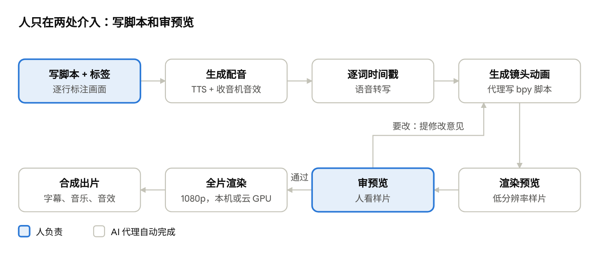

# 小波深夜电台 · 节目设定

> 导出自 Claude 在线文档《小波深夜电台 · 节目设定》的"节目设定"标签页（2026-10-27）。建模所需的细化规范见 `01_show_bible.md`、`03_room_layout.md` 等。

Oct 26, 2026 · @MinTao

## 节目概述

《小波深夜电台》是一档全 3D 制作的 AI 与科技讲解节目：收音机头机器人小波在 70 年代复古客厅里当深夜电台主播，滚球宠物滚滚负责捣乱和调节节奏。

| 项目 | 设定 |
| --- | --- |
| 内容领域 | AI 与科技 |
| 画幅 | 横屏 16:9，1080p |
| 单期时长 | 3–5 分钟 |
| 核心概念 | 深夜电台：观众是"听众"，开场调频、结尾"下期同一频率见" |
| 制作路线 | 全 3D（Blender），角色、宠物、场景全部建模，由 AI 代理按脚本自动出片 |
| 视觉风格 | 70 年代复古科技客厅，夜晚，风格化（非写实）角色 |

房间、角色、动作库是一次性资产；每期只换脚本、白板内容、电视画面和桌面道具。

## 场景：70 年代复古科技客厅

房间按机位分成五个区域，每个区域就是一个镜头；布局要紧凑，让全景能同时看到所有区域。

| 区域 | 内容 | 镜头用途 |
| --- | --- | --- |
| 主讲区 | 矮桌、小波、背后深橄榄绿墙 + 木格栅、球形落地灯、熔岩灯 | 出镜时间最长，背景要耐看 |
| 复古电视 | 显像管电视，放在主讲区侧后方的木质矮柜上 | 显示节目标题、本期主题，播放画面 |
| 翻页挂图 | 木质三脚画架 + 奶油色大纸 + 笔筒 | 图解、要点、翻页转场 |
| 工作台 | 木质工作台、洞洞板工具墙、桌面机械臂、台灯聚光 | 机械臂抓放道具，类似产品展示台 |
| 宠物角 | 藤编窝 / 充电垫、小玩具，在主讲镜头的画面边缘 | 滚滚随时"闯入"主讲镜头 |
| 全景 | 能看到以上所有区域 + 窗外城市夜景 | 开场定位、转场 |

**家具与陈设**：焦橙色圆角沙发、米白长毛地毯、黄铜台灯、黑胶唱机和唱片架、龟背竹等绿植配陶瓷盆、墙上一块青绿色小霓虹标识。所有造型走中古风的圆润几何形。

**固定不变**：房间结构、家具、灯光布置、角色。

**每期变化**：电视画面、翻页挂图内容、桌面道具、滚滚的位置和状态、节日小装饰。

**彩蛋**：小波的充电座、贴满便签的工具墙、滚滚藏起来的东西，供老观众寻找。

## 配色、材质与灯光

房间整体走暖色，小波的荧光青绿屏幕脸是画面里唯一的冷色和最亮的地方。用量按 60 / 30 / 10 分配：暗部基底 60%，家具与角色 30%，青绿点缀 10%。

| 角色 | 颜色 | 参考色值 | 用在哪里 |
| --- | --- | --- | --- |
| 暗部基底 | 深胡桃木棕 | #4A2F1D | 木墙板、格栅、地板 |
| 墙面 | 深橄榄绿 | #3F4A3A | 主讲区背后的墙 |
| 主色 1 | 焦橙 | #C8612B | 沙发、单椅、机械臂外壳 |
| 主色 2 | 芥末黄 | #D4A62A | 抱枕、灯罩、滚滚外壳 |
| 中性色 | 奶油白 | #EDE0C4 | 小波外壳、挂图纸、球形灯 |
| 品牌色 | 荧光青绿 | #4FE3C1 | 小波屏幕脸、霓虹标识、少量摆件 |
| 细节 | 黄铜 | #B08D57 | 台灯支架、机械臂关节、把手 |

**材质**：以哑光为主，避免屏幕脸在光滑表面上反射；金属只做点缀；质感靠木纹、布料、毛毡、陶瓷的粗糙度变化来体现。颜色略带灰度，只有青绿允许"亮"。

**夜晚布光**

| 灯 | 作用 | 做法 |
| --- | --- | --- |
| 主光 | 照亮小波 | 侧前方 45° 大面积柔光，暖色 |
| 辅光 | 控制阴影 | 另一侧，低强度 |
| 轮廓光 | 把小波和背景分开 | 窗外冷蓝色月光，从背后勾边 |
| 实用光 | 营造氛围 | 球形落地灯、蘑菇台灯、书架灯带、熔岩灯，2200–2700K |
| 屏幕脸 | 角色本身是光源 | 颜色投到胸前和桌面，随情绪变色 |
| 电视 | 背景光源 | 播放画面时在墙上投出微弱的彩色光 |

**氛围细节**：轻微体积雾产生光束；主讲镜头背景轻微虚化；窗外下雨或城市灯光闪烁；绿植轻摇、熔岩灯流动、光束里的灰尘颗粒，保证画面始终有微动。

**坑**：暖色不能铺满，否则夜里会糊成泥土色；主讲区背景要比小波暗一档。

## 角色：小波

小波是一个原创的收音机头机器人，深夜电台主播：说话温和、节奏偏慢，偶尔冷幽默和自嘲，像一个懂行的朋友在深夜陪你聊科技。

**造型**

- 头：横向偏宽的胶囊形，正面是屏幕脸，两侧扬声器网罩当"耳朵"，顶上一根可伸缩天线
- 配色：奶油白外壳 + 焦橙面板或关节，深棕色屏幕边框，青绿色屏幕脸
- 比例：Q 版，头和身体约 1:1.5
- 移动：轮式底座滑行，不做走路
- 手：两只简化手臂，三指或连指手套形状；硬质零件，不需要刷权重
- 天线：情绪指示器，兴奋时竖起，沮丧时耷拉

**屏幕脸表情**

| 情绪 | 脸部颜色 | 眼睛 / 图标 |
| --- | --- | --- |
| 默认 / 讲解 | 青绿 | 两个圆角矩形，偶尔眨眼 |
| 开心 / 兴奋 | 琥珀黄 | 弯成弧线的笑眼 |
| 思考 | 冰蓝 | 加载圈 |
| 疑惑 | 淡紫 | 问号 |
| 强调 / 警告 | 橙红 | 感叹号 |
| 想到主意 | 琥珀黄 | 小灯泡 |
| 喜欢 | 琥珀黄 | 爱心 |
| 无奈 | 青绿 | 半睁的一字眼 |

嘴是一条线，跟着音量张合。屏幕加轻微扫描线和偶尔闪烁；开机时从一条横线展开，关机时缩回一条线。

**动作库（第一版）**：待机循环（呼吸、轻晃）、讲解手势、指向挂图、翻页、指向电视、挥手、低头看滚滚、无奈摇头、点头、滑行到挂图 / 工作台。

**声音**：TTS 温和、偏中低音的声线，加一点"老收音机"效果（压窄频段 + 轻微暖色失真），不用重度机器人变声，清晰度优先。

**口头禅**：开场"调到频道了吗？"，结尾"下期同一频率见"。

## 角色：滚滚与机械臂

滚滚和小波形成反差：小波稳重，滚滚好动、好奇、爱捣乱；机械臂是沉默寡言、一丝不苟的老伙计。

**滚滚**

- 造型：圆球形，芥末黄 + 奶油白外壳，小屏幕只显示两个圆点眼睛，头顶一根小天线（和小波是一家人）
- 移动：滚动、弹跳，不做走路
- 声音：不说话，用原创电子音效（短促哔哔声、上扬滑音、开心时一串快速音符）

| 动作 | 含义 |
| --- | --- |
| 原地弹跳两下 | 赞同 |
| 快速转圈 | 兴奋 |
| 滚到沙发后，只露天线 | 害怕 |
| 滚到挂图前盯着看 | 好奇 |
| 在窝里天线耷拉、眼睛闭上 | 睡觉 |
| 偷偷把道具推开 | 捣乱（固定梗） |

**固定梗**：机械臂刚把道具放好，滚滚就滚过去把它推开；机械臂停顿一下，像在叹气；小波无奈地看它一眼。

**桌面机械臂**

- 造型：焦橙外壳 + 黄铜关节，像 70 年代实验室设备；底座、旋转关节、大臂、小臂、手腕、夹爪，全是硬质零件
- 绑定：反向动力学（IK），只给夹爪目标位置，关节角度自动算
- 抓放流程（固定模板）：待机位 → 移到物体上方 → 下降 → 夹紧 → 抬起 → 移到目标 → 放下 → 松开 → 回待机位；每次只换"拿什么、放哪里、什么时候放"
- 对时：动作在关键词前 1–2 秒开始，说到那个词时刚好放下
- 声音：伺服电机嗡嗡声 + 夹爪咔哒声

**道具库（AI 与科技方向，第一批）**：按发布方官方品牌规范使用的 AI 产品 logo 立体牌、芯片、服务器小模型、秒表、积木（表示数量或时长）、问号方块、奖杯、价格牌。新的一期需要什么就往库里加。

## 翻页挂图与复古电视

挂图负责"讲清楚"，电视负责"给你看"：概念和步骤用挂图画，产品界面和演示画面上电视。

**翻页挂图**

- 造型：木质三脚画架 + 一叠奶油色大纸 + 挂在旁边的马克笔筒
- 内容风格：粗马克笔手绘，只用三色——深棕黑写正文、焦橙标重点、青绿画箭头和圈注
- 第一版：内容按逐词时间戳自己逐笔画出来，小波在旁边指着讲
- 后期：小波拿笔亲手写
- 转场：一个要点讲完就翻页，翻页动作本身就是话题切换

**复古电视**

- 造型：木纹外壳的显像管电视，屏幕带弧度、扫描线和轻微辉光
- 平时：显示节目标志、本期标题或屏保
- 播放画面：视频作为电视屏幕的动态贴图，自动加上复古屏幕效果
- 推进转场：镜头推向电视，屏幕铺满画面后切成全屏播放，播完再拉回房间，适合需要看清细节的演示
- 小波的配合动作：转向电视、用手指着屏幕

**电视画面的素材来源**：自己录的屏幕操作、自己做的界面和动画、官方公开允许使用的媒体素材、可商用的免版权素材库。不下载别人平台上的视频来用。

## 节目结构与镜头规则

每期按同一套六段结构走，主体讲 2–4 个要点；下表以一期 4 分钟为例。

| 段落 | 时长 | 主要镜头 | 内容 |
| --- | --- | --- | --- |
| 1. 开场 | 约 5 秒 | 全景 → 主讲 | 调频沙沙声，屏幕脸亮起，"调到频道了吗？" |
| 2. 今日话题 | 约 20 秒 | 主讲 + 电视 | 抛出问题，电视显示本期标题 |
| 3. 要点讲解 | 约 2–3.5 分钟 | 主讲 / 挂图 / 工作台 / 电视 | 每个要点：小波讲 → 挂图图解或电视演示 → 机械臂放道具 |
| 4. 滚滚桥段 | 约 10 秒 | 主讲 / 工作台 | 插在要点之间，调节节奏 |
| 5. 总结 | 约 20 秒 | 挂图 → 主讲 | 翻到最后一页，一句话总结 |
| 6. 结尾 | 约 5 秒 | 主讲 → 全景 | "下期同一频率见"，屏幕脸缩成一条线 |

**镜头规则（每期通用）**

1. 运镜先拉远、再移动、再缓推，不硬切着跳机位
2. 一次只给一个视觉焦点
3. 不裁切主体，不出现黑帧或空帧
4. 任何画面静止不超过 8 秒
5. 小波的屏幕脸始终是主讲镜头里最亮的地方
6. 转场用调频杂音、屏幕雪花、翻页或推进电视，不用通用的淡入淡出
7. 字幕逐词高亮，放在画面下方安全区，不挡住挂图和电视

## 制作流水线与第一版验证

人只写带标签的脚本并审预览，其余步骤由 AI 代理用代码驱动 Blender 自动完成；所有镜头和动作都对着配音的逐词时间戳走。

预览不通过就把意见交回代理重做镜头，通过后才花时间渲染全片。

**脚本标签写法**

| 标签 | 示例 | 效果 |
| --- | --- | --- |
| 镜头 | `[镜头:挂图]` | 切到指定机位 |
| 表情 | `[表情:小灯泡]` | 屏幕脸切换表情和颜色 |
| 动作 | `[动作:指电视]` | 小波做指定动作 |
| 挂图 | `[挂图:三步流程图]` | 挂图逐笔画出内容，必要时先翻页 |
| 电视 | `[电视:demo.mp4 推进]` | 电视播放画面，可选推进全屏 |
| 机械臂 | `[机械臂:放置 道具=芯片 位置=桌面中]` | 在关键词时刻放下道具 |
| 滚滚 | `[滚滚:捣乱]` | 触发宠物动作 |

没有标签的句子，由代理按默认规则自动安排镜头。

**技术路线**

- 建模与动画：Blender，由代理写 Python（bpy）脚本在无界面模式下生成
- 渲染：风格化画面用 Eevee，先在本机 Mac 渲；不够快再上云 GPU 分帧渲染
- 配音：TTS 生成小波的声音，再加老收音机效果
- 时间戳：语音转写拿到逐词时间，驱动镜头、口型、动作关键帧
- 口型：屏幕脸的嘴按音量大小张合，不需要复杂口型系统
- 合成：ffmpeg 拼接帧序列、字幕、配音、音乐和音效

**第一版验证（约 10 秒样片）**

- [ ] 搭房间白模 + 主讲机位，定材质和夜晚灯光
- [ ] 建小波，屏幕脸做出默认和 2 个表情
- [ ] 小波说一句话，嘴跟着音量张合
- [ ] 小波转身指向挂图，挂图写出一个关键词
- [ ] 合成出片，审阅画面和对时
- [ ] 跑通后依次加入：电视、机械臂与道具库、滚滚

详细技术方案和机械臂资产评估见 [技术方案](00_技术方案.md)。

## 原创与合规

角色、场景、音效全部原创，发布时标注 AI 生成，这两点开拍前就定下来。

- 小波、滚滚、机械臂的造型不做得像任何知名机器人或动画角色；宠物电子音和小波声线也不模仿知名角色或真人
- 节目名和角色名先在各平台搜一遍，确认没有同名的知名账号或商标
- 国内自 2025 年 9 月 1 日起施行《人工智能生成合成内容标识办法》，AI 生成的视频需要显式标识；发布时勾选平台的 AI 生成声明
- 产品 logo 和界面按各公司公开的品牌使用规范来用，用于介绍和评论，不暗示官方合作或赞助
- 电视画面只用自己录制、自己制作或有授权的素材
- 背景音乐用可商用的曲库或自己生成的音乐
